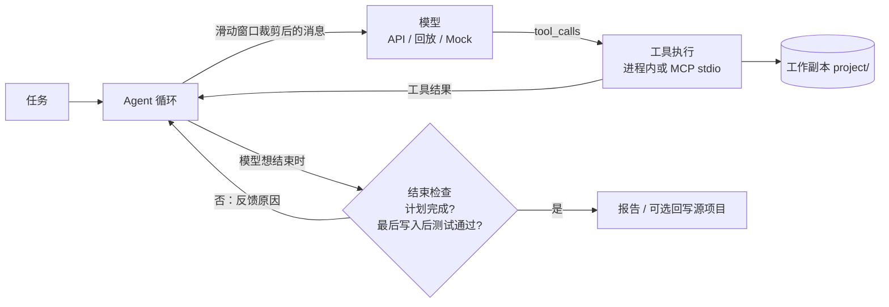

# ForgeAgent

一个**自动修复代码缺陷的编程 Agent**：读代码、跑测试、改代码、再验证，直到测试真正通过。用 TypeScript 从零实现，不依赖 LangChain 等 Agent 框架或 MCP SDK。

## 亮点

- **严格的完成判定**：只有“计划全部完成”且“最后一次写入之后测试通过”才算成功，模型说“完成了”不算数。
- **禁止改测试**：入口处工具拒绝写测试文件，出口处逐个对比基线文件，杜绝靠改测试“刷通过”。
- **隔离执行**：每次运行在独立工作副本（复制目录或 git worktree）上进行，测试可放进 Docker 沙箱（默认断网、限制资源）。
- **上下文工程**：滑动窗口（不拆开工具调用与结果）、固定前缀命中前缀缓存、工具输出截断、规则 / 模型摘要、仓库概览，每项都有开关，可做消融实验。
- **可靠的模型调用**：429 / 5xx 指数退避加随机抖动重试、上下文超限缩小窗口重发、手写 SSE 流式解析、重复操作检测。
- **手写 MCP 与 RAG**：stdio JSON-RPC 的 MCP 服务端；BM25 与向量检索用 RRF 融合，向量存储可切换内存 / Qdrant。
- **多种执行策略**：ReAct（默认）、Plan-and-Execute，以及可选的只读子 Agent 并行调查。
- **可回放、可评测**：每轮模型请求落盘，可零成本离线回放；自带 10 个任务的评测集和结构化运行报告。

## 评测结果

10 个注入了 bug 的 TypeScript 任务（off-by-one、空值、异步、跨文件调用等），每个任务跑 3 次，ReAct，最多 10 轮。通过 = Agent 以 `passed` 结束 + 评测脚本独立重跑全量测试通过 + 没有修改测试。

| 运行 | 模型 | 通过 | pass@1 | pass@3 | 平均 token |
|---|---|---|---|---|---|
| 基线（2026-10-25） | qwen3.7-plus | 21/30 | 70.0% | 100% | 25,526 |
| 修复完成判定后（2026-10-26） | qwen3.6-plus | 28/30 | 93.3% | 100% | 22,909 |

基线的 9 次未通过都来自 harness 的完成判定问题（代码其实已修好），修复后重新评测。两次用的模型不同，不能当作同一模型的提升。另有单任务真实运行：SWE-bench Pro 的 ansible 任务简化版，修复前 70 个子测试失败，修复后全部通过（qwen3.7-plus，10 轮，+22 / -1 行）。分析见 [docs/GUIDE.md](docs/GUIDE.md#真实模型运行结果)。

## 30 秒体验（无需 API key）

```bash
npm install
npm run agent -- --replay mock-data/2026-10-17T08-20-57-131Z_619f7ef9
```

重放一次真实模型运行的录音：不调用 API，但文件读写和测试都真实执行，结果与原始运行一致。

## 使用真实模型

```bash
cp .env.example .env    # 填写 QWEN_API_KEY、QWEN_BASE_URL、QWEN_MODEL
npm run agent -- --task "检查 average 对 null 和空数组的处理，修复问题并运行测试"
npm run agent -- --source /absolute/path/to/project --sandbox docker --image node:24
npm run chat -- --ask "这段代码有什么问题？" --file src/tools.ts  # 只读审查，可交互追问
npm run eval            # 10 个任务 × 3 次
npm test
```

需要 Node.js 24+。

## 架构



| 模块 | 文件 |
|---|---|
| Agent 循环、结束检查、回写 | `src/agent.ts` |
| 对话式代码审查、引用核验与评测 | `src/chat.ts`、`src/eval/review.ts` |
| 工具定义与执行、测试运行器 | `src/tools.ts` |
| 工作副本、测试保护 | `src/workspace.ts`、`src/guard.ts` |
| 模型请求：重试、流式（SSE） | `src/model/` |
| 执行策略、子 Agent | `src/strategy/`、`src/subagents.ts` |
| 上下文工程 | `src/context/`、`src/features.ts` |
| MCP 客户端 / 服务端 | `src/mcp/` |
| RAG：BM25、RRF、VectorStore（内存 / Qdrant） | `src/rag/` |

## 文档

完整说明见 [docs/GUIDE.md](docs/GUIDE.md)：执行环境与 Docker 沙箱、SWE-bench Pro、执行策略、模型调用与重复检测、上下文工程、运行报告、评测方法、RAG 与 Qdrant 规模实验、手写 MCP。
