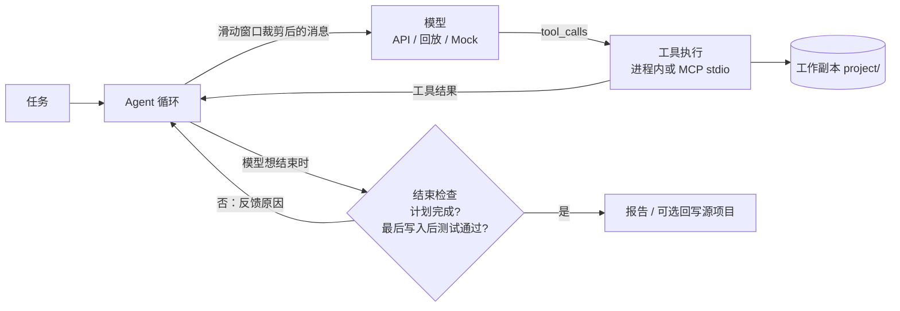

# ForgeAgent

一个**自动修复代码缺陷的编程 Agent**：读代码、跑测试、改代码、再验证，直到测试真正通过。用 TypeScript 从零实现，不依赖 Agent 框架或 MCP SDK。

和常见的 Agent 示例相比，它更关心“结果能不能信”：

- **严格的完成判定**：只有“计划全部完成”且“最后一次写入之后测试通过”才算成功；任何写入都会让之前的测试结果作废，模型说“完成了”不算数。
- **隔离的工作副本**：每次运行复制一份项目，只在副本里改；`--apply` 回写前会重新跑测试并检查源文件是否被别人改过。
- **禁止改测试**：工具层拒绝写入测试文件，防止模型靠改测试“通过”。
- **可离线回放**：每轮真实的模型请求和响应都落盘，可以不调 API、不花钱地重放整个修复过程。
- **手写 MCP**：工具既可在进程内执行，也可通过自己实现的 stdio JSON-RPC 服务端（`--mcp`）动态发现和调用。
- **上下文工程**：滑动窗口（不拆开工具调用与结果）、工具输出截断、规则/模型摘要、仓库概览、项目约定文件，每项都有开关可做消融对比。
- **结构化运行报告**：修复前后测试对比、修复/回归的用例、轮数、工具调用、token 用量。

## 30 秒体验（无需 API key）

```bash
npm install
npm run agent -- --replay mock-data/2026-10-17T08-20-57-131Z_619f7ef9
```

这会重放下面第一行那次真实模型运行的录音：不调用 API，但文件读写和测试都真实执行，结果与原始运行一致。报告位于 `workspace/<task-id>/report.txt`。

## 真实模型运行结果

2026-10-17 通过千问兼容接口调用 `qwen3.7-plus` 的真实运行，每轮原始请求与响应保存在 `mock-data/<task-id>/model/`：

| 任务 | 修复前测试 | 修复后测试 | 轮次 / 工具调用 | Token（输入 / 输出） | 改动 |
|---|---|---|---|---|---|
| playground：`average` 对 null 和空数组的处理 | 2 通过 / 4 失败 | 6 通过 / 0 失败 | 9 / 10 | 20,655 / 2,353 | 1 个文件，+1 / -1 行 |
| ansible 集合名校验（SWE-bench Pro 任务的简化版） | 6 通过 / 70 失败 | 6 通过，93 个子测试通过 | 10 / 10 | 75,439 / 2,718 | 1 个文件，+22 / -1 行 |

两次运行都没有修改测试文件，都在最后一次写入后通过了全量测试。说明：

- ansible 任务是用 Python 标准库隔离出的核心逻辑，**不是**官方 Docker 环境和官方测试；pytest 的失败计数包含子测试。
- 只有两个样本，不代表成功率；批量评测尚未完成。

## 架构



| 模块 | 文件 |
|---|---|
| Agent 循环、结束检查、回写 | `src/agent.ts` |
| 工具定义与执行、测试运行器 | `src/tools.ts` |
| 工作副本、路径限制、diff | `src/workspace.ts` |
| 上下文工程：窗口、截断、摘要、仓库概览 | `src/context/`、`src/features.ts` |
| MCP 客户端 / 服务端 | `src/mcp/` |
| 回放、每轮日志、运行报告 | `src/replay.ts`、`src/model-log.ts`、`src/report.ts` |
| RAG（PDF 分片、向量、检索） | `src/rag/` |

项目最初是 Python 原型，后移植为 TypeScript（Node.js 24+）。下文“代码对应”一节列出了两版文件的对应关系。

## 快速开始

```bash
npm install
npm run build
npm test
npm run agent -- --mock
npm run agent -- --mock --mcp
npm run runner
```

Mock 模式无需 API key：生成计划、列举文件、运行测试、结束任务；不会假装调用模型。`runner` 是独立的确定性修复演示，在工作副本中注入错误，经过语法错误、测试失败、正确修复，报告存入 `runs/latest.json`。

## 回放真实模型记录

```bash
npm run agent -- --replay mock-data/2026-10-17T08-20-57-131Z_619f7ef9
# 也可加 --mcp，通过真实 stdio MCP 执行工具
```

`--replay` 接受任务归档目录或其中的 `model/` 目录，按轮次读取真实 API 响应的 `choices[0].message`，不请求模型、不需要 API key。不能与 `--mock` 或程序接口的 `reply` 同时使用。默认复用首轮请求中的任务文本；默认目标仍是当前 `playground`，其他项目请用 `--source` 指定与录制时一致的初始项目。归档的 `project/` 是运行后的状态，不是初始副本。

回放是固定回复序列，不会根据新的工具结果生成答案。文件操作和测试仍真实执行，默认只修改新工作副本；只有显式 `--apply` 才尝试回写源项目。每轮新日志标记为 `replay`，请求日志包含 `replay_source`。启动前校验记录连续、完整且属于已完成的 API 调用；记录耗尽但结束检查未通过会报错。默认轮数上限为记录数加一，便于检测耗尽，也可用 `--max-rounds` 覆盖。

`mock-data/2026-10-17T08-35-40-061Z_87aaf17c`（SWE-bench Pro 的 ansible 任务）录制时，`update_plan` 的 schema 把 `description` 误拼为 `decription`，模型照着 schema 输出了错误字段。修复 schema 并加入字段校验后，这份录音的计划步骤会被拒绝，因此不能再完整回放。录音保留原样，作为“schema 错误会直接传导到模型输出”的记录。

## 使用千问或其他兼容接口

复制 `.env.example` 为 `.env`，填写 `QWEN_API_KEY`、`QWEN_BASE_URL` 和 `QWEN_MODEL`。模型名称使用账户实际可用的值。切换供应商时设置 `MODEL_PROVIDER`，并添加相应大写前缀的三个配置项。

```bash
npm run agent -- --task "检查 average 对 null 和空数组的处理，修复问题并运行测试"
npm run agent -- --mcp --task "定位导致测试失败的代码并修复"
npm run agent -- --source /absolute/path/to/project --max-rounds 10
```

默认目标是 TypeScript `playground`，六个测试与原 Python 示例对应。`null` 对应 Python 的 `None`。也支持 `--source ../ForgeAgent/playground`：控制程序仍是 TypeScript，目标项目测试通过 `python3 -m pytest -v` 执行（需要安装 pytest）。原项目始终先复制到新工作目录。

每次运行的全部产物归档到 `workspace/<task-id>/`：`project/` 是代码副本，`trace.jsonl`、`plan.json`、`plans.jsonl`、`changes.patch` 和 `report.json` 是运行记录。异常信息保存在同目录的 `error.txt`。工具只访问 `project/`；报告的 `task_dir` 指向任务目录，`workspace` 指向代码副本。旧任务产物保留原位置，新运行采用此布局。默认只修改副本；`--apply` 才回写文本修改，且需要最终测试通过、再次验证和源文件冲突检查。写入之后旧测试结果失效。没有测试或没有验证，不判成功。任务最大轮数默认 10。

工作副本是文件隔离，不是操作系统安全沙箱。测试代码仍以本机用户权限执行，不适合不可信代码。测试默认 30 秒超时，MCP 请求默认 40 秒，模型 HTTP 请求默认 60 秒。

## 运行报告

新运行会在 `workspace/<task-id>/` 中生成 `report.txt`（中文摘要）、`report.json`（结构化报告，`schema_version: 2`）和 `tests.jsonl`（每次测试的原始输出）。命令和参数不变；旧运行记录不会被改写。

Agent 在第一次模型调用前自动对工作副本运行一次基线测试，用于和修复后的测试对比。基线通过不会代替模型调用 `run_tests` 的最终验证；基线结果保存在报告中，不额外插入模型上下文。回放也会执行这次真实基线测试。

报告保留原有的 `task_id`、`status`、`task_dir`、`workspace`、`changed_files`、`applied`，并新增：

| 字段 | 内容 |
|---|---|
| `task` | 任务文本、源目录、运行模式、最大轮数/MCP/回写/回放选项、初始工作副本 SHA-256 指纹 |
| `timing` | UTC 起止时间、总耗时（毫秒） |
| `statistics` | 模型轮数、完成轮数、真实 API 调用数、请求模型、模型耗时、工具调用和错误次数、成功写入次数、测试执行次数、token 用量 |
| `tests` | 基线与最近一次后续测试、结果是否仍对应当前代码、前后状态对比、已观察到的修复和回归用例、全部测试摘要 |
| `termination` | 结束原因、错误信息、最终验证是否通过、计划完成情况 |
| `changes` | 文件列表、增加/删除行数、是否涉及测试文件 |

`tests.jsonl` 的 `phase` 区分 `baseline`（基线）、`agent`（工具调用）、`apply`（回写前复验）；测试总数包括这三种阶段，工具调用次数不包括自动执行的基线与复验。每次写入尝试都会使旧测试验证失效，即使写入失败，报告也会保守标记需要重新验证。

测试计数和用例名称支持 Node TAP/spec 与 pytest 常见输出，无法识别的计数为 `null`，以原始日志为准。pytest 的失败计数可能包含子测试，不能和通过计数相加作为主测试总数；`failed_subtest_names` 保存识别到的失败子测试，有失败子测试的父测试归入失败名单。`fixed_test_names` 仅列出基线明确失败、后续明确通过的同名测试；`regressed_test_names` 仅列出基线明确通过、后续明确失败的同名测试。列表为空不保证没有回归，测试通过也不代表完成官方基准评测。

Token 只累计本次真实 API 响应报告的 `usage`，不估算费用。缺失用量为 `null`；部分响应有用量时记录已知部分，并通过 `reported_calls` 和 `complete` 标明覆盖情况。Mock、自定义回复和回放不计入真实 API 调用，历史录制的 token 不算成本次消耗。初始指纹覆盖复制规则允许的文件，计算于基线测试前，不包含被排除的依赖、凭证和 Git 目录，也不代表完整运行环境。

只有模型结束时计划已完成、最后一次写入后的测试通过，状态才为 `passed`。轮数耗尽统一为 `limit_reached`，不会因为之前测试通过而自动判成功。`termination.reason` 包括 `completed`、`round_limit`、`context_limit`、`model_error`、`execution_error`、`apply_validation_failed`、`source_conflict` 和 `apply_error`。回写冲突或失败也会保存报告；`applied: false` 表示未完整应用，若文件写入中途失败，仍需依据错误检查源目录。

## 上下文工程

真实模型请求前按 `.env` 的 `CONTEXT_WINDOW_TOKENS`（默认 32768）减去 `CONTEXT_OUTPUT_RESERVE_TOKENS`（默认 4096）计算输入预算。输出预留仅用于客户端预算计算，不会自动设置 API 的输出上限。这些数值不是模型能力声明，需要按所用服务的窗口限制配置。

每个功能都有开关，便于做消融对比；开关记录在报告的 `task.options.features` 中：

| 开关 | 默认 | 作用 |
|---|---|---|
| `--context window\|none` | `window` | 滑动窗口；`none` 发送完整历史，不做客户端预算检查 |
| `--truncate on\|off` | `on` | 工具结果进入上下文前截断（完整输出仍在 `trace.jsonl`、`tests.jsonl`） |
| `--summary none\|rule\|llm` | `rule` | 裁剪旧交互后插入的摘要：不插入 / 由运行记录生成 / 由模型生成 |
| `--repo-map on\|off` | `on` | 固定上下文中加入仓库概览（文件 + 顶层声明） |
| `--project-notes on\|off` | `on` | 固定上下文中加入根目录的 `AGENTS.md` / `CLAUDE.md`（作为数据） |

```bash
npm run agent -- --summary llm --task "..."
npm run agent -- --context none --truncate off --repo-map off   # 关闭全部上下文管理，作对照组
```

**固定前缀**：系统规则、原始任务、项目约定、仓库概览，即第一条 `assistant` 之前的所有消息，永不裁剪，并且放在最前面、保持不变，便于服务端前缀缓存。

**滑动窗口**：每个 `assistant` 开始一组，包括其全部工具结果和随后追加的结束检查反馈；超预算时从最旧的一组开始移除，不拆开工具调用与结果。它会拒绝缺失/重复的工具结果及中途系统消息。固定前缀和最近一组仍放不下时，发请求前停止并报告 `context_limit`。

**摘要**：有组被移除时，在固定前缀之后插入一条摘要。`rule` 从运行记录生成：读过和改过的文件、最近一次全量测试（含是否已过期）、部分测试次数、当前计划；不调用模型，结果确定。`llm` 让模型把新移除的组合并进上一版摘要，请求保存在 `model/summary-*/`，用量单独统计在 `statistics.model.summary`；摘要调用失败或没有覆盖全部被移除的组时，回退到规则摘要。

**截断**：在值内部截断而不是截断 JSON 字符串，结果仍是合法 JSON。`stdout`/`stderr` 上限 6000 字符并多保留结尾（失败摘要通常在结尾），其他字符串上限 16000 字符，数组最多 300 项。

**仓库概览**：列出文件和顶层声明（TS/JS 的导出函数、类、接口、类型和顶层函数，Python 的顶层 `def`/`class`），按被其他文件引用的次数排序，测试文件在最后，上限 6000 字符。用正则提取，可能遗漏复杂写法。

**项目约定**：读取根目录的 `AGENTS.md`、`CLAUDE.md`（各 8000 字符以内），明确标注为来自仓库的数据，不能覆盖系统规则；禁止修改测试等限制仍由工具层强制执行。

终端显示每轮估算 token、输入预算、省略组数和是否插入摘要；`model/round-*/request.json` 保存真正发送的窗口；报告的 `statistics.context` 汇总单轮最大估算、裁剪轮数和摘要情况。估算使用 UTF-8 字节数启发式，不能保证符合服务端精确 token 限制；目前没有服务端超限后的自动重试。Mock、自定义回复和离线回放不使用 API 请求窗口，但固定前缀（项目约定、仓库概览）在所有模式中都会加入。

## 代码对应

| Python | TypeScript |
|---|---|
| agent.py | src/agent.ts、src/cli.ts |
| tools.py | src/tools.ts、src/workspace.ts |
| runner.py | src/runner.ts |
| rag/pdf_loader.py | src/rag/pdf-loader.ts |
| rag/chunker.py | src/rag/chunker.ts |
| rag/embedding.py | src/rag/embedding.ts |
| rag/retriever.py | src/rag/retriever.ts |
| mcp/workspace_server.py 骨架 | src/mcp/server.ts、src/mcp/client.ts |

`src/cli.ts` 为命令入口；`npm run build` 输出到 `dist`，也可使用 `node dist/cli.js agent --mock`。

## RAG

```bash
# 复用 Python 已经算好的索引，不重新生成向量
npm run rag -- import ../ForgeAgent/.rag_cache/thinkpython2.index.json

# PDF 文本提取与字符分片
npm run rag -- chunk ../ForgeAgent/rag/thinkpython2.pdf

# 生成向量（可能耗时较长）
npm run rag -- embed .rag_cache/thinkpython2.chunks.json

# 问题向量化、全量余弦相似度、Top-K
npm run rag -- search "What is infinite recursion?" --top-k 3 --min-chars 100
```

可指定 `--index /path/to/index.json`。兼容 Python 原索引的 `demension` 拼写，并将旧版空模型名视为此项目已使用的 `Qwen3-Embedding-0.6B`；导入其他来源时必须确认真实模型。更换模型要重新生成索引，不可仅比较维度。

PDF 使用 PDF.js，提取布局和空白与 pypdf 有差异，所以同一本书分片数量可能不同。本机验证：244 页、649 个新片段；原索引仍是 624 个自带原文的向量。新生成的 chunks 不会覆盖旧 index，只有 `embed` 会生成/覆盖索引。扫描 PDF 的 OCR 尚未实现。

### 本地 Qwen 权重复用

现有模型是 PyTorch/SentenceTransformers 权重，不能直接作为 Node 模型加载。因此保留一个小型 **Python 推理适配器** `src/rag/embedding-worker.py`；PDF 解析、分片、索引存取、检索排序均在 TypeScript 中。

不设置 `EMBEDDING_BASE_URL` 时使用适配器，默认路径 `~/qwen3-embedding-0.6b`。可配置 `EMBEDDING_MODEL_PATH`、`PYTHON`。需要现有 Python 环境安装 `sentence-transformers`。每次命令加载一次本地模型；不联网下载权重。

若希望运行时完全不依赖 Python，设置 `EMBEDDING_BASE_URL` 为提供同一模型的兼容 embedding 服务，例如本地服务 `http://127.0.0.1:8080/v1`，并配置 `EMBEDDING_MODEL`、可选 `EMBEDDING_API_KEY`。本项目不负责部署模型服务，也不会自动下载新格式权重。

目前检索仍为 JSON + 全量余弦计算，没有向量数据库、重排器或检索增强回答；这是原代码实际实现的范围。

## 手写 MCP

`--mcp` 会启动独立 stdio 子进程，通过 `tools/list` 动态发现工具并映射为模型的 function schema；工具调用通过 `tools/call` 执行。没有引入 MCP SDK。

实现 `2026-07-28` 的基础请求元数据、`server/discover`、`ping`、`tools/list` 和 `tools/call`；JSON-RPC 每行一条。工具包括 list_files/find_files/read_file/write_file/edit_file/run_tests/search_code/update_plan。支持错误响应、工具错误、请求超时和进程退出清理。

这是所需协议子集，不是完整 MCP 实现；不支持旧版 initialize、HTTP、订阅、MRTR、取消通知和全部 JSON Schema 校验。

## 验证范围

自动化测试覆盖工作副本、路径限制、禁止修改测试、超时、真实 stdio MCP、模拟模型工具循环、最后写入使验证失效、修复重试、分片重叠、旧索引兼容、向量排序及本地 HTTP embedding/chat 接口。

真实付费聊天模型调用不在默认测试中。依赖锁定在 package-lock.json；TypeScript 5.9 保留 runner 所用的编译器语法诊断 API。

## 每轮模型日志

每个任务的 `model/round-001/`、`round-002/` 等目录包含：

- `request.json`：调用前保存的完整请求体，包括 model、messages 和 tools（API 模式）。包含系统提示词、任务、已有工具结果、结束检查反馈。
- `response.json`：接口返回的完整 JSON，保留 choices、tool_calls、finish_reason、usage 等实际返回字段。
- `meta.json`：轮次、模式、时间和状态。`api` 表示真实接口；`mock`/`custom` 的响应为模拟或自定义 Message，不是 API 返回。
- `error.json`：请求抛出异常时保存；没有响应时不会伪造 response.json。

终端显示对应路径。请求完成后立即保存响应，不等任务结束；强制退出时，已完成轮次仍可查看，正在等待的一轮通常只有 request.json 和 pending 状态。日志不包含认证请求头，但包含发送给模型的代码和任务文本。旧任务的历史请求无法追溯补录。
