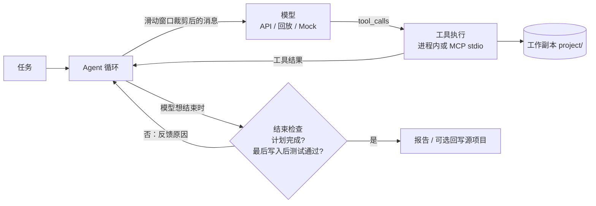

# ForgeAgent

一个**自动修复代码缺陷的编程 Agent**：读代码、跑测试、改代码、再验证，直到测试真正通过。用 TypeScript 从零实现，不依赖 Agent 框架或 MCP SDK。

和常见的 Agent 示例相比，它更关心“结果能不能信”：

- **严格的完成判定**：只有“计划全部完成”且“最后一次写入之后测试通过”才算成功；任何写入都会让之前的测试结果作废，模型说“完成了”不算数。
- **隔离的工作副本**：每次运行复制一份项目（或在 git 仓库上建 worktree 分支），只在副本里改；`--apply` 回写前会重新跑测试并检查源文件是否被别人改过，git 模式则提交到独立分支。测试可以放进 Docker 容器，默认断网、限制资源。
- **禁止改测试，两层防护**：入口——工具拒绝写测试文件、`conftest.py` 等测试配置，以及 `package.json` 的 test 脚本、pytest 配置段；出口——结束检查对比基线中的每个文件，测试或测试配置有任何变化都不能结束，不管改动来自哪里。
- **可离线回放**：每轮真实的模型请求和响应都落盘，可以不调 API、不花钱地重放整个修复过程。
- **手写 MCP**：工具既可在进程内执行，也可通过自己实现的 stdio JSON-RPC 服务端（`--mcp`）动态发现和调用。
- **上下文工程**：滑动窗口（不拆开工具调用与结果）、工具输出截断、规则/模型摘要、仓库概览、项目约定文件，每项都有开关可做消融对比。
- **可靠的模型调用**：429/5xx/网络错误按指数退避加随机抖动重试并尊重 `Retry-After`；服务端报上下文超限时缩小窗口重发；可选流式输出（手写 SSE 解析）；重复操作检测先警告、再终止。
- **两种执行策略**：默认 ReAct 工具循环（模型自己维护计划）；`--strategy plan-execute` 时规划器先探索再提交带验收条件的步骤，执行器逐步在独立上下文中完成，由程序验收，失败时有上限地重新规划。
- **文档检索（RAG）**：`search_docs` 工具对项目文档做 BM25 检索，配置向量索引时与向量检索用 RRF 融合；只在有文档时提供给模型，并有 recall@k / MRR 评测。
- **结构化运行报告**：修复前后测试对比、修复/回归的用例、轮数、工具调用、token 用量。

## 30 秒体验（无需 API key）

```bash
npm install
npm run agent -- --replay mock-data/2026-10-17T08-20-57-131Z_619f7ef9
```

这会重放下面第一行那次真实模型运行的录音：不调用 API，但文件读写和测试都真实执行，结果与原始运行一致。报告位于 `workspace/<task-id>/report.txt`。

## 真实模型运行结果

2026-10-17 通过千问兼容接口调用 `qwen3.7-plus` 的真实运行，每轮原始请求与响应保存在 `mock-data/<task-id>/model/`：

| 任务 | 修复前测试 | 修复后测试 | 轮次 / 工具调用 | Token（输入 / 输出） | 改动 |
|---|---|---|---|---|---|
| playground：`average` 对 null 和空数组的处理 | 2 通过 / 4 失败 | 6 通过 / 0 失败 | 9 / 10 | 20,655 / 2,353 | 1 个文件，+1 / -1 行 |
| ansible 集合名校验（SWE-bench Pro 任务的简化版） | 6 通过 / 70 失败 | 6 通过，93 个子测试通过 | 10 / 10 | 75,439 / 2,718 | 1 个文件，+22 / -1 行 |

两次运行都没有修改测试文件，都在最后一次写入后通过了全量测试。说明：

- ansible 任务是用 Python 标准库隔离出的核心逻辑，**不是**官方 Docker 环境和官方测试；pytest 的失败计数包含子测试。
- 只有两个样本，不代表成功率；批量结果见下面的评测基线。

### 评测基线（2026-10-25）

`npm run eval -- --label baseline`：`qwen3.7-plus`，ReAct，最大 10 轮，默认功能开关，10 个任务各 3 次。完整结果在 `eval/results/eval-2026-10-25T05-49-16-242Z-baseline.{md,json}`。

**通过 21/30，pass@1 = 70.0%，pass@3 = 100%**（每个任务至少通过一次）。30 次运行共 765,773 tokens，耗时约 22 分钟；通过的运行平均 7.9 轮。

| 任务 | 类型 | 通过 | 平均轮数 | 平均 token |
|---|---|---|---|---|
| pagination-last-page | off-by-one | 3/3 | 7.3 | 18,915 |
| leaderboard-mutation | 副作用 | 3/3 | 7.7 | 20,651 |
| settings-parsing | 类型转换 | 3/3 | 9.3 | 29,450 |
| display-name-null | 空值处理 | 2/3 | 8.7 | 24,624 |
| invoice-rounding | 跨文件调用 | 2/3 | 8.3 | 26,825 |
| lru-cache | 数据结构 | 2/3 | 8.7 | 27,527 |
| retry-errors | 错误处理 | 2/3 | 8.0 | 24,465 |
| slugify-spaces | 字符串处理 | 2/3 | 8.7 | 27,120 |
| grade-boundaries | 边界条件 | 1/3 | 9.3 | 28,794 |
| load-all-async | 异步 | 1/3 | 9.3 | 26,886 |

**9 次未通过全部是 `round_limit`，而且代码其实都已修好**：评测脚本独立重跑测试，9 次全部通过。逐轮查看记录，原因完全一致：这 9 次运行第一次跑测试时都带了 `target`（正好是项目里唯一的测试文件），被算作“部分测试”，不能作为验证；结束检查又提示“最后一次修改后的测试没有通过”，而测试其实是通过的。模型于是再跑全量测试、重新读文件、更新计划，多用 2–3 轮后撞上 10 轮上限。21 次通过的运行第一次都直接跑了全量测试。所以这份基线测的主要是 harness 的这个问题，而不是模型修 bug 的能力；分任务的差异主要来自模型是否先跑了 `target`，3 次的样本量下不能说明哪类 bug 更难。

这个问题已修复：`target` 恰好是唯一的测试文件时算作全量测试；结束检查会如实说明是“全量测试没有通过”、“只运行了部分测试”还是“修改后还没跑测试”。修复后在 `qwen3.6-plus` 上重新评测（2026-10-26，`eval/results/eval-2026-10-26T04-55-47-118Z-fix-r10-36.md`）：**通过 28/30，pass@1 = 93.3%，pass@3 = 100%**，2 次未通过都是 `round_limit`。模型与上表不同，两组数字不能当作同一模型的提升；上表是修复前的结果。

## 架构



| 模块 | 文件 |
|---|---|
| Agent 循环、结束检查、回写 | `src/agent.ts` |
| 工具定义与执行、测试运行器 | `src/tools.ts` |
| 工作副本（复制 / git worktree）、路径限制、diff | `src/workspace.ts` |
| 测试保护（入口拦截 + 出口校验） | `src/guard.ts` |
| 模型请求：重试、流式（SSE）、错误分类 | `src/model/` |
| 重复检测 | `src/loop.ts` |
| Plan-and-Execute 策略 | `src/strategy/plan-execute.ts` |
| SWE-bench Pro 适配 | `src/bench/swe-pro.ts` |
| 上下文工程：窗口、截断、摘要、仓库概览 | `src/context/`、`src/features.ts` |
| MCP 客户端 / 服务端 | `src/mcp/` |
| 回放、每轮日志、运行报告 | `src/replay.ts`、`src/model-log.ts`、`src/report.ts` |
| RAG：BM25、RRF 混合检索、文档切分、检索评测、PDF 向量索引、VectorStore（内存 / Qdrant） | `src/rag/` |

项目最初是 Python 原型，后移植为 TypeScript（Node.js 24+）。下文“代码对应”一节列出了两版文件的对应关系。

## 快速开始

```bash
npm install
npm run build
npm test
npm run agent -- --mock
npm run agent -- --mock --mcp
npm run runner
```

Mock 模式无需 API key，演示工具调用流程：生成计划、列举文件、运行测试、尝试结束；不修改代码，也不会假装调用模型。默认 playground 有缺陷，结束检查不通过，所以 mock 运行会以 `limit_reached` 结束——这正是严格判定的体现。`runner` 是不调用模型的确定性修复演示：把 `stats_helpers.ts` 的 `count()` 设为已知缺陷（与 playground 的真实缺陷相同），依次尝试语法错误、错误修复、正确修复，每次都跑测试，报告存入 `runs/latest.json`。

## 回放真实模型记录

```bash
npm run agent -- --replay mock-data/2026-10-17T08-20-57-131Z_619f7ef9
# 也可加 --mcp，通过真实 stdio MCP 执行工具
```

`--replay` 接受任务归档目录或其中的 `model/` 目录，按轮次读取真实 API 响应的 `choices[0].message`，不请求模型、不需要 API key。不能与 `--mock` 或程序接口的 `reply` 同时使用。默认复用首轮请求中的任务文本；默认目标仍是当前 `playground`，其他项目请用 `--source` 指定与录制时一致的初始项目。归档的 `project/` 是运行后的状态，不是初始副本。

回放是固定回复序列，不会根据新的工具结果生成答案。文件操作和测试仍真实执行，默认只修改新工作副本；只有显式 `--apply` 才尝试回写源项目。每轮新日志标记为 `replay`，请求日志包含 `replay_source`。启动前校验记录连续、完整且属于已完成的 API 调用；记录耗尽但结束检查未通过会报错。默认轮数上限为记录数加一，便于检测耗尽，也可用 `--max-rounds` 覆盖。

`mock-data/2026-10-17T08-35-40-061Z_87aaf17c`（SWE-bench Pro 的 ansible 任务）录制时，`update_plan` 的 schema 把 `description` 误拼为 `decription`，模型照着 schema 输出了错误字段。修复 schema 并加入字段校验后，这份录音的计划步骤会被拒绝，因此不能再完整回放。录音保留原样，作为“schema 错误会直接传导到模型输出”的记录。

## 使用千问或其他兼容接口

复制 `.env.example` 为 `.env`，填写 `QWEN_API_KEY`、`QWEN_BASE_URL` 和 `QWEN_MODEL`。模型名称使用账户实际可用的值。切换供应商时设置 `MODEL_PROVIDER`，并添加相应大写前缀的三个配置项。

```bash
npm run agent -- --task "检查 average 对 null 和空数组的处理，修复问题并运行测试"
npm run agent -- --mcp --task "定位导致测试失败的代码并修复"
npm run agent -- --source /absolute/path/to/project --max-rounds 10
```

默认目标是 TypeScript `playground`，六个测试与原 Python 示例对应。`null` 对应 Python 的 `None`。也支持 `--source ../ForgeAgent/playground`：控制程序仍是 TypeScript，目标项目测试通过 `python3 -m pytest -v` 执行（需要安装 pytest）。原项目始终先复制到新工作目录。

每次运行的全部产物归档到 `workspace/<task-id>/`：`project/` 是代码副本，`trace.jsonl`、`plan.json`、`plans.jsonl`、`changes.patch` 和 `report.json` 是运行记录。异常信息保存在同目录的 `error.txt`。工具只访问 `project/`；报告的 `task_dir` 指向任务目录，`workspace` 指向代码副本。旧任务产物保留原位置，新运行采用此布局。默认只修改副本；`--apply` 才回写，覆盖所有文件（包括新建、删除和二进制文件），且需要最终测试通过、再次验证和源文件冲突检查（按字节比较，区分空文件和不存在）。写入之后旧测试结果失效。没有测试或没有验证，不判成功。任务最大轮数默认 10。

默认的工作副本只是文件隔离，测试代码以本机用户权限执行；不可信代码请用下文的 Docker 沙箱。测试默认 30 秒超时（`--test-timeout` 可改），MCP 请求默认 40 秒，模型 HTTP 请求默认 60 秒。

## 执行环境

| 参数 | 作用 |
|---|---|
| `--workspace copy\|git` | `copy`（默认）复制项目，排除依赖和凭证；`git` 在源仓库上建 worktree，分支名 `forge/<task-id>`，只包含已提交内容，文件列表遵守 `.gitignore`；源仓库有未提交修改或不是仓库根目录时拒绝 |
| `--apply` | copy 模式写回源目录；git 模式提交到 `forge/<task-id>` 分支，不碰用户的检出，由用户自己合并 |
| `--setup-command "npm ci"` | 在基线测试前于工作副本中执行（10 分钟超时），产生的文件不算 Agent 的改动；失败时以 `setup_error` 结束，不调用模型 |
| `--test-command "npm test"` | 用自定义命令代替自动识别；此时 `run_tests` 只能跑全量 |
| `--sandbox docker --image node:24` | 测试（和准备命令）在容器中运行：项目挂载到 `/workspace`，`--network none`、2 CPU、2 GB 内存、512 进程上限、`no-new-privileges`；超时会按容器名 `docker kill` |
| `--sandbox-network on` | 允许测试联网（默认关闭；准备命令总是联网以便安装依赖） |
| `--preserve /app/node_modules` | 保留镜像中的目录（匿名卷），用于依赖装在镜像里、但项目目录被挂载覆盖的情况；可重复 |

git worktree 会登记在源仓库中；删除 `workspace/` 下的任务目录后，在源仓库运行 `git worktree prune` 清理登记。

### SWE-bench Pro（需要 Docker）

```bash
npm run swe -- instance_NodeBB__NodeBB-f9ce92df988db7c1ae55d9ef96d247d27478bc70-vf2cf3cbd463b7ad942381f1c6d077626485a1e9e --pro-dir ../SWE-bench_Pro-os
```

1. 从任务镜像导出 `/app`（排除 `node_modules`、`.git`），缓存在 `swe-sources/<instance_id>`；
2. Agent 在副本上工作，`run_tests` 用官方 `run_script.sh` 在镜像中运行实例指定的测试文件，镜像里的 `node_modules` 以匿名卷保留；
3. 结束后再跑一次官方测试，用官方 `parser.py` 解析，FAIL_TO_PASS 与 PASS_TO_PASS 全部通过才算解决（没运行的用例算失败），结果写入 `swe-report.json`。

任务说明与镜像来自 `tasks/swe-bench-pro/<name>/` 的 `instruction.md` 和 `metadata.json`（需要 `docker_image`）。**本机未安装 Docker，这条链路只验证了命令构造、解析和判定逻辑，尚未端到端运行。**

## 执行策略：ReAct 与 Plan-and-Execute

**ReAct（默认）**：一个工具循环，每轮模型决定调用哪些工具、看结果再决定下一步；计划由模型通过 `update_plan` 自己维护，程序只检查“同时最多一个进行中”和“结束时全部完成”。

**Plan-and-Execute**（`--strategy plan-execute`）：

1. **规划**：规划器只能用只读工具（列文件、读文件、搜索、跑测试）先了解项目，再调用 `submit_plan` 提交 2–8 个步骤，每步包含目标、完成标准和验收方式——`full_tests`（全量测试）、`tests:<测试文件>`（指定测试）或 `none`。计划由程序校验（字段、验收格式、步骤数、id 不重复），无效时把错误返回给规划器重交；规划阶段调用写入工具会被拒绝。
2. **执行**：每个步骤一个**全新的对话**，只包含任务、整个计划（标出当前步骤）和已完成步骤的交接说明（总结、改动文件、验收结果），不带之前步骤的完整记录。执行器用完整工具集，完成时调用 `complete_step`，做不了就 `report_blocked`；每步有轮数上限（`--step-rounds`，默认 8）。
3. **验收**：`complete_step` 之后由**程序**按验收方式跑测试（记录为 `verify` 阶段），模型说完成不算数；第一次不通过把失败输出反馈给执行器，第二次不通过视为步骤失败。
4. **重新规划**：步骤受阻、超出轮数或两次验收失败时，重新规划器拿到当前计划、交接说明和失败原因，只规划剩余工作（已完成步骤保留）；次数上限 `--max-replans`（默认 2），超出以 `replan_limit` 结束。
5. **最终检查**：所有步骤完成后，程序再跑一次全量测试并做测试改动检查（与 ReAct 相同）；不通过也会触发重新规划，而不是直接报成功。

所有角色的模型调用共用一个连续的轮次编号，所以日志、统计和回放与 ReAct 一致；默认总轮数为 30（`--max-rounds` 可改）。报告 `statistics.plan_execute` 记录计划版本数、重新规划次数、最终检查次数，以及每步的轮数、验收次数、结果和总结。mock 模式只演示 ReAct，不支持此策略。两种策略孰优孰劣尚无评测数据：小 bug 用 ReAct 可能更省，多文件长任务才可能体现分步的优势。

**子 agent**（`--subagents on`，只用于 ReAct，默认关）：主 agent 多一个 `agent` 工具，参数是类型和任务说明。子 agent 在**全新的对话**里跑同一个工具循环（只带自己的系统提示、任务说明和固定上下文，不带主 agent 的历史），用完只把结论作为工具结果交回，它读过的文件和测试输出不进入主 agent 的上下文。

- **类型**：`explore`（列文件、找文件、读文件、搜索代码和文档，最多 8 轮）和 `verify`（另加 `run_tests`，最多 6 轮）。两者都**只读**，调用白名单以外的工具会得到“子 agent 不能使用 …”的错误；子 agent 没有 `agent` 工具，所以只派发一层。
- **并行**：同一轮最多 3 个 `agent` 调用，真实 API 模式下同时运行；脚本、mock 和回放模式按顺序运行，保证模型轮次可复现。它们在本轮其他工具调用**之前**执行，所以同一轮的写入不会和子 agent 的读取交错。
- **结束**：子 agent 不再调用工具时，它的文字就是报告（截断到 4000 字符）；超出轮数以 `round_limit` 结束；有自己的重复检测，检测到一次就以 `loop_detected` 结束；模型出错以 `error` 结束。无论哪种，主 agent 都会拿到一个结果，可以缩小问题后重新派发。
- **共享与记录**：子 agent 的模型调用占用同一个轮次编号，工具调用写入同一个 `trace.jsonl`（带 `agent` 字段）；`verify` 跑的全量测试和主 agent 自己跑的一样计入验证。报告 `statistics.subagents.runs` 记录每个子 agent 的类型、结果、轮数和工具调用数。
- **未实现**：会写文件的子 agent（需要 worktree 隔离）、后台运行、agent 之间互发消息。效果尚无评测数据。

## 模型调用与重复检测

**重试**：429、408、409、425、5xx 和网络错误（含超时）会重试，最多 `MODEL_MAX_RETRIES` 次（默认 3）。等待时间是“full jitter”：在 `min(MODEL_RETRY_MAX_MS, MODEL_RETRY_BASE_MS × 2^n)` 内取随机值（默认基数 1 秒、上限 30 秒），并且不早于服务端 `Retry-After`；服务端要求等待超过 2 分钟时直接失败。400、401、403、404 不重试。每轮的重试次数写入 `model/round-*/meta.json`，汇总在 `statistics.model_requests`；模型摘要请求同样走重试。

**服务端上下文超限**：客户端 token 只是估算，服务端仍可能返回“超出上下文”（按 400/413 和错误内容识别）。这时同一轮把输入预算乘以 0.7 重新裁剪窗口再发，最多两次；关闭上下文管理（`--context none`）时无可裁剪，直接以 `server_context_limit` 结束，便于在对照实验中统计。上下文超限不按普通错误重试——同样的请求只会再失败。

**流式输出**（`--stream`）：请求带 `stream: true` 和 `stream_options.include_usage`，边收边打印文本。手写的 SSE 解析按空行切分事件、处理跨网络分块的半行和半个多字节字符、忽略注释行；工具调用的 `id`、名称和 JSON 参数按 `index` 分片到达，拼成与非流式相同的响应结构后再写日志、交给 Agent 循环，所以回放和统计不受影响。超时是**空闲超时**（60 秒没有新数据），持续输出的长回答不会被误杀；中途失败的流按整次请求重试，不保留半截输出。

**重复检测**（`--loop-guard`，默认开）：三类“连续 3 次相同”——相同工具 + 相同参数（参数按键排序后比较）、期间没有写入的相同全量测试结果、相同原因的结束检查失败。第一次检测到时，在本轮所有工具结果之后插入一条提醒；再次检测到时以 `failed` / `loop_detected` 结束。检测记录在 `statistics.loop`。

## 运行报告

新运行会在 `workspace/<task-id>/` 中生成 `report.txt`（中文摘要）、`report.json`（结构化报告，`schema_version: 2`）和 `tests.jsonl`（每次测试的原始输出）。命令和参数不变；旧运行记录不会被改写。

Agent 在第一次模型调用前自动对工作副本运行一次基线测试，用于和修复后的测试对比。基线通过不会代替模型调用 `run_tests` 的最终验证；基线结果保存在报告中，不额外插入模型上下文。回放也会执行这次真实基线测试。

报告保留原有的 `task_id`、`status`、`task_dir`、`workspace`、`changed_files`、`applied`，并新增：

| 字段 | 内容 |
|---|---|
| `task` | 任务文本、源目录、运行模式、最大轮数/MCP/回写/回放选项、初始工作副本 SHA-256 指纹 |
| `timing` | UTC 起止时间、总耗时（毫秒） |
| `statistics` | 模型轮数、完成轮数、真实 API 调用数、请求模型、模型耗时、工具调用和错误次数、成功写入次数、测试执行次数、token 用量 |
| `tests` | 基线与最近一次后续测试、结果是否仍对应当前代码、前后状态对比、已观察到的修复和回归用例、全部测试摘要 |
| `termination` | 结束原因、错误信息、最终验证是否通过、计划完成情况 |
| `changes` | 文件列表（含新建、删除、二进制标记）、增加/删除行数、是否涉及测试文件或测试配置 |

`tests.jsonl` 的 `phase` 区分 `baseline`（基线）、`agent`（工具调用）、`apply`（回写前复验）；测试总数包括这三种阶段，工具调用次数不包括自动执行的基线与复验。每次写入尝试都会使旧测试验证失效，即使写入失败，报告也会保守标记需要重新验证。

测试计数和用例名称支持 Node TAP/spec 与 pytest 常见输出，无法识别的计数为 `null`，以原始日志为准。pytest 的失败计数可能包含子测试，不能和通过计数相加作为主测试总数；`failed_subtest_names` 保存识别到的失败子测试，有失败子测试的父测试归入失败名单。`fixed_test_names` 仅列出基线明确失败、后续明确通过的同名测试；`regressed_test_names` 仅列出基线明确通过、后续明确失败的同名测试。列表为空不保证没有回归，测试通过也不代表完成官方基准评测。

Token 只累计本次真实 API 响应报告的 `usage`，不估算费用。缺失用量为 `null`；部分响应有用量时记录已知部分，并通过 `reported_calls` 和 `complete` 标明覆盖情况。Mock、自定义回复和回放不计入真实 API 调用，历史录制的 token 不算成本次消耗。初始指纹覆盖复制规则允许的文件，计算于基线测试前，不包含被排除的依赖、凭证和 Git 目录，也不代表完整运行环境。

只有模型结束时计划已完成、最后一次写入后的测试通过，状态才为 `passed`。轮数耗尽统一为 `limit_reached`，不会因为之前测试通过而自动判成功。`termination.reason` 包括 `completed`、`round_limit`、`planning_failed`、`replan_limit`、`context_limit`、`server_context_limit`、`loop_detected`、`model_error`、`execution_error`、`setup_error`、`apply_validation_failed`、`source_conflict` 和 `apply_error`。`termination.test_tampering` 列出相对基线被改动的测试文件和测试配置；git 模式下 `branch`、`applied_commit` 给出结果所在分支和提交；`setup` 记录准备命令的退出码。回写冲突或失败也会保存报告；`applied: false` 表示未完整应用，若文件写入中途失败，仍需依据错误检查源目录。

## 上下文工程

真实模型请求前按 `.env` 的 `CONTEXT_WINDOW_TOKENS`（默认 32768）减去 `CONTEXT_OUTPUT_RESERVE_TOKENS`（默认 4096）计算输入预算。输出预留仅用于客户端预算计算，不会自动设置 API 的输出上限。这些数值不是模型能力声明，需要按所用服务的窗口限制配置。

每个功能都有开关，便于做消融对比；开关记录在报告的 `task.options.features` 中：

| 开关 | 默认 | 作用 |
|---|---|---|
| `--context window\|none` | `window` | 滑动窗口；`none` 发送完整历史，不做客户端预算检查 |
| `--truncate on\|off` | `on` | 工具结果进入上下文前截断（完整输出仍在 `trace.jsonl`、`tests.jsonl`） |
| `--summary none\|rule\|llm` | `rule` | 裁剪旧交互后插入的摘要：不插入 / 由运行记录生成 / 由模型生成 |
| `--repo-map on\|off` | `on` | 固定上下文中加入仓库概览（文件 + 顶层声明） |
| `--project-notes on\|off` | `on` | 固定上下文中加入根目录的 `AGENTS.md` / `CLAUDE.md`（作为数据） |
| `--loop-guard on\|off` | `on` | 重复检测（见“模型调用与重复检测”） |
| `--docs on\|off` | `on` | 有文档（或 `--docs-index`）时向模型提供 `search_docs`（见“RAG”） |
| `--edit-tool on\|off` | `on` | 提供 `edit_file`；`off` 时只剩 `write_file` 整份写入，系统提示和 `write_file` 的说明随之改写，模型仍调用 `edit_file` 时按未知工具拒绝 |
| `--diagnostics on\|off` | `on` | `write_file` / `edit_file` 的结果附带写入后的语法检查 |
| `--subagents on\|off` | `off` | 只用于 ReAct：提供 `agent` 工具，派发只读子 agent（见“执行策略”） |
| `--vector-store memory\|qdrant` | `memory` | `--docs-index` 的向量放在哪里检索：内存精确扫描，或本地 Qdrant（见“向量数据库：Qdrant”） |

```bash
npm run agent -- --summary llm --task "..."
npm run agent -- --context none --truncate off --repo-map off   # 关闭全部上下文管理，作对照组
```

**固定前缀**：系统规则、原始任务、项目约定、仓库概览，即第一条 `assistant` 之前的所有消息，永不裁剪，并且放在最前面、保持不变，便于服务端前缀缓存。

**滑动窗口**：每个 `assistant` 开始一组，包括其全部工具结果和随后追加的结束检查反馈；超预算时从最旧的一组开始移除，不拆开工具调用与结果。它会拒绝缺失/重复的工具结果及中途系统消息。固定前缀和最近一组仍放不下时，发请求前停止并报告 `context_limit`。

**摘要**：有组被移除时，在固定前缀之后插入一条摘要。`rule` 从运行记录生成：读过和改过的文件、最近一次全量测试（含是否已过期）、部分测试次数、当前计划；不调用模型，结果确定。`llm` 让模型把新移除的组合并进上一版摘要，请求保存在 `model/summary-*/`，用量单独统计在 `statistics.model.summary`；摘要调用失败或没有覆盖全部被移除的组时，回退到规则摘要。

**截断**：在值内部截断而不是截断 JSON 字符串，结果仍是合法 JSON。`stdout`/`stderr` 上限 6000 字符并多保留结尾（失败摘要通常在结尾），其他字符串上限 16000 字符，数组最多 300 项。

**仓库概览**：列出文件和顶层声明（TS/JS 的导出函数、类、接口、类型和顶层函数，Python 的顶层 `def`/`class`），按被其他文件引用的次数排序，测试文件在最后，上限 6000 字符。用正则提取，可能遗漏复杂写法。

**项目约定**：读取根目录的 `AGENTS.md`、`CLAUDE.md`（各 8000 字符以内），明确标注为来自仓库的数据，不能覆盖系统规则；禁止修改测试等限制仍由工具层强制执行。

终端显示每轮估算 token、输入预算、省略组数和是否插入摘要；`model/round-*/request.json` 保存真正发送的窗口；报告的 `statistics.context` 汇总单轮最大估算、裁剪轮数和摘要情况。估算使用 UTF-8 字节数启发式，不能保证符合服务端精确 token 限制；目前没有服务端超限后的自动重试。Mock、自定义回复和离线回放不使用 API 请求窗口，但固定前缀（项目约定、仓库概览）在所有模式中都会加入。

## 评测

`npm run eval` 把 `eval/tasks/` 下的每个任务各跑 N 次（默认 3），汇总通过率和成本。上面的功能开关和 `--strategy` 都可以传给它，所以只改一个开关重跑一遍就是一组消融对比：

```bash
npm run eval                                               # 全部任务 × 3 次，使用 .env 中的模型
npm run eval -- --repeat 5 --tasks lru-cache,retry-errors  # 只跑部分任务
npm run eval -- --summary none --label summary-off         # 消融：关掉摘要，结果文件带标签
npm run eval -- --strategy plan-execute --label plan
npm run eval -- --mock --repeat 1                          # 不调用 API，只检查评测流程
```

每个任务是一个目录：`instruction.md`（给 Agent 的任务，写法类似 issue）、`project/`（注入了 bug 的小项目和测试）、`task.json`（bug 类型，可选 `test_command`）、`solution/`（参考修复，只用于测试检查任务本身，不会复制给 Agent）。现有 10 个 TypeScript 任务，覆盖 off-by-one、边界条件、空值、异步、跨文件调用、类型转换、副作用、字符串处理、数据结构和错误处理；`test/eval.test.ts` 保证每个任务修复前测试失败、套用参考修复后通过。

**通过判定**比 Agent 的自我报告更严格：Agent 以 `passed` 结束、评测脚本在最终工作副本上**独立重跑**全量测试通过，且没有修改测试文件，三者同时满足才算通过。单次运行出错（模型故障、准备命令失败等）只记为未通过，不会中断评测。

结果写到 `eval/results/eval-<时间戳>[-标签].md` 和 `.json`：每个任务的通过次数、平均轮数、工具调用数、token（含模型摘要调用；平均数和中位数，输入、输出分开）、平均裁剪轮数（`rounds_with_dropping`，为 0 说明上下文管理没起作用）、耗时和未通过原因，以及 pass@1 和 pass@N（无偏估计）。`config.context` 记录本次使用的 `CONTEXT_WINDOW_TOKENS` 和 `CONTEXT_OUTPUT_RESERVE_TOKENS`。JSON 里的 `task_dir` 指向每次运行的完整记录。任务按顺序执行，目前不支持并发。

### 故障注入

`npm run faults` 检查错误处理在真实运行路径上是否按设计工作，不调用模型、不花 token。`eval/faults/recordings/pagination-last-page/` 保存了一次真实通过的运行（6 轮的原始 API 响应和最终改动）；本地代理冒充模型服务按顺序返回这些响应，并在指定的轮次和第几次请求注入 HTTP 错误。被注入故障的请求不消耗录制，所以重试成功后模型拿到的还是同一轮的回答，正常结果就是“和录制一模一样”。Agent 走真实 API 模式（使用独立的 `FAULTPROXY_*` 设置，不读取 `.env` 里的密钥）。

```bash
npm run faults                                              # 全部场景
npm run faults -- --scenarios 429-backoff,429-stream        # 只跑部分场景
```

目前是 8 个 429 场景：Retry-After 秒数和 HTTP 日期、无 Retry-After 的退避、重试耗尽、Retry-After 超过 2 分钟、运行中途限流、流式模式、额度耗尽（`insufficient_quota`）。每个场景检查结束原因、重试次数、每轮请求数和 `meta.json` 里的重试记录、重试前等待时间、重试请求是否与首次完全相同；应当恢复的场景还要求状态、轮数、token 数和改动都与录制相同。结果写到 `eval/results/faults-<时间戳>.md` 和 `.json`。

已知未通过：额度耗尽的 429 仍会重试 3 次（`isRetryable` 只看状态码）。

## 代码对应

| Python | TypeScript |
|---|---|
| agent.py | src/agent.ts、src/cli.ts |
| tools.py | src/tools.ts、src/workspace.ts |
| runner.py | src/runner.ts |
| rag/pdf_loader.py | src/rag/pdf-loader.ts |
| rag/chunker.py | src/rag/chunker.ts |
| rag/embedding.py | src/rag/embedding.ts |
| rag/retriever.py | src/rag/retriever.ts |
| mcp/workspace_server.py 骨架 | src/mcp/server.ts、src/mcp/client.ts |

`src/cli.ts` 为命令入口；`npm run build` 输出到 `dist`，也可使用 `node dist/cli.js agent --mock`。

## RAG

```bash
# 复用 Python 已经算好的索引，不重新生成向量
npm run rag -- import ../ForgeAgent/.rag_cache/thinkpython2.index.json

# PDF 文本提取与字符分片
npm run rag -- chunk ../ForgeAgent/rag/thinkpython2.pdf

# 生成向量（可能耗时较长）
npm run rag -- embed .rag_cache/thinkpython2.chunks.json

# 问题向量化、全量余弦相似度、Top-K
npm run rag -- search "What is infinite recursion?" --top-k 3 --min-chars 100
```

可指定 `--index /path/to/index.json`。兼容 Python 原索引的 `demension` 拼写，并将旧版空模型名视为此项目已使用的 `Qwen3-Embedding-0.6B`；导入其他来源时必须确认真实模型。更换模型要重新生成索引，不可仅比较维度。

PDF 使用 PDF.js，提取布局和空白与 pypdf 有差异，所以同一本书分片数量可能不同。本机验证：244 页、649 个新片段；原索引仍是 624 个自带原文的向量。新生成的 chunks 不会覆盖旧 index，只有 `embed` 会生成/覆盖索引。扫描 PDF 的 OCR 尚未实现。

### 本地 Qwen 权重复用

现有模型是 PyTorch/SentenceTransformers 权重，不能直接作为 Node 模型加载。因此保留一个小型 **Python 推理适配器** `src/rag/embedding-worker.py`；PDF 解析、分片、索引存取、检索排序均在 TypeScript 中。

不设置 `EMBEDDING_BASE_URL` 时使用适配器，默认路径 `~/qwen3-embedding-0.6b`。可配置 `EMBEDDING_MODEL_PATH`、`PYTHON`。需要现有 Python 环境安装 `sentence-transformers`。每次命令加载一次本地模型；不联网下载权重。

若希望运行时完全不依赖 Python，设置 `EMBEDDING_BASE_URL` 为提供同一模型的兼容 embedding 服务，例如本地服务 `http://127.0.0.1:8080/v1`，并配置 `EMBEDDING_MODEL`、可选 `EMBEDDING_API_KEY`。本项目不负责部署模型服务，也不会自动下载新格式权重。

`rag -- search` 仍是 JSON 索引 + 对全部向量做点积（加载时归一化一次，Top-K 用小顶堆）。`search_docs` 的向量检索走 `VectorStore` 接口，可以换成 Qdrant（见下文）。没有重排器。

### 接入 Agent：search_docs

`search_docs(query, top_k)` 检索工作副本中的文档（`md`/`mdx`/`txt`/`rst`/`adoc`），以及 `--docs-index` 指定的预建向量索引（如上面由 PDF 生成的索引）。

- **切分**：按 Markdown 标题分节，再把空行分隔的段落打包到 1200 字符以内；代码块（```）整体保留，其中的 `#` 注释不当作标题。每个片段带标题路径和行号范围（如 `README.md:137-145`），模型可以再用 `read_file` 按行读取。
- **BM25**：不依赖任何模型。分词兼顾中英文和代码：英文转小写、去停用词，`camelCase`/`snake_case` 标识符额外拆分；中文用相邻两字（bigram）。倒排索引只给包含查询词的片段打分。
- **混合检索**：索引带向量且 embedding 模型可用时，再按余弦相似度排序，两路结果用 RRF（`1 / (60 + 名次)` 相加）融合，不需要把 BM25 分数和余弦分数换算到同一尺度；embedding 不可用时自动退回 BM25，并在结果中说明。
- **只在有用时提供**：工作副本没有文档、也没有索引时，不把 `search_docs` 交给模型；`--docs off` 可关闭。文档被修改后索引按文件大小和修改时间自动重建。
- **检索评测**：`eval-docs` 计算 recall@k 和 MRR。`eval/docs-cases.json` 是 12 个针对本文档的中文问题（按章节标题标注相关性）。

```bash
npm run rag -- search-docs "search_docs 怎么切分文档" --top-k 3
npm run rag -- eval-docs eval/docs-cases.json --top-k 5
npm run agent -- --docs-index .rag_cache/thinkpython2.index.json --task "..."
```

实测结果（只用 BM25，未配置 embedding，在项目根目录运行上面的命令）：**recall@5 = 0.917，MRR = 0.736**（12 个问题，2026-10-27）。这次把原 README 拆成简短的首页和本文档：首页的亮点、评测摘要和文档目录与本文档对应章节竞争，4 个问题的正确章节从第 1 名降到第 2 或第 3 名（首页排第 1）。拆分前 MRR 为 0.917（2026-10-25），更早为 0.875，变化都来自语料本身，标注没有改。唯一未命中的问题关于离线回放：排第一的是开头的快速体验一节，内容同样相关，但标注只指向回放一节；标注保持原样，不在看到结果后修改。评测问题不要原样出现在被检索的文档里，否则会泄漏。样本很小，只能说明检索链路可用。


### 向量数据库：Qdrant

`search_docs` 的向量检索走 `VectorStore` 接口（`src/rag/vector-store.ts`）：默认 `ExactStore` 在内存里精确扫描，零依赖；`--vector-store qdrant` 改用本地 Qdrant（`src/rag/qdrant-store.ts`）。Qdrant 用官方 macOS/Linux 原生二进制，不需要 Docker。

```bash
npm run qdrant:install   # 下载 v1.20.0 并校验 SHA-256，放到 .qdrant/bin（约 27 MB 压缩包）
npm run qdrant           # 前台运行，REST 端口 6333，数据在 .qdrant/storage；QDRANT_URL 可改地址

npm run rag -- search-docs "What is infinite recursion?" --docs-index .rag_cache/thinkpython2.index.json --vector-store qdrant
npm run agent -- --docs-index .rag_cache/thinkpython2.index.json --vector-store qdrant --task "..."
npm run rag -- eval-matrix --qdrant                              # 对照矩阵加上 Qdrant 精确 / HNSW 两种后端
npm run rag -- scale --sizes 10000,100000,300000 --quantization  # 规模实验
```

- **约定**：向量由调用方归一化，存储层不再归一化，余弦就是点积；`ExactStore` 用 Float64Array，排序与原来的内联点积逐位一致。
- **ID**：Qdrant 的点 ID 只能是整数或 UUID，字符串 ID 经 SHA-256 映射为 UUID，原 ID 放在 payload 里，upsert 幂等。
- **集合复用**：`search_docs` 的集合名带索引文件的哈希，索引不变就不重复上传，变了自动重建。
- **小集合不建 HNSW**：Qdrant 默认在约 20 MB 以下只做全量扫描。`search_docs` 保留这个默认值（624 条 × 1024 维约 2.5 MB，全量扫描更快）；矩阵和规模实验用 `forceIndex` 强制建图，等 `indexed_vectors_count` 追上点数才开始计时。
- **降级**：Qdrant 查询出错和 embedding 出错一样，退回 BM25 并在结果里说明。

**对照矩阵**（Think Python 624 条、README 25 条）：Qdrant 精确和 HNSW 的前 40 个结果与内存精确检索完全一致，recall@5 / MRR 不变。规模这么小，HNSW 的近似误差体现不出来，所以另做了规模实验。

**规模实验**（2026-10-25，Apple Silicon、16 GB 内存，1024 维，68 个真实评测问题，top-10，HNSW `m=16`、`ef_construct=100`）。语料是合成的：两条真实片段向量按 0.5–1 的权重混合，加噪声后归一化。数字只说明趋势，不代表真实语料上的召回。

| N | 内存精确 p50 | Qdrant 精确 p50 | HNSW ef=64 | HNSW ef=256 | int8 + ef=256 |
|---|---|---|---|---|---|
| 1 万 | 21 ms | 2.3 ms | 99.0%，1.8 ms | 100%，3.1 ms | 100%，1.6 ms |
| 10 万 | 224 ms | 7.5 ms | 90.4%，1.7 ms | 99.1%，3.0 ms | 98.8%，2.1 ms |
| 30 万 | 789 ms | 22 ms | 79.8%，13.8 ms | 92.9%，11.8 ms | 92.9%，2.2 ms |

- 内存精确扫描（JS）随 N 线性变慢，10 万条已经超过 200 ms；Qdrant 的精确扫描（Rust SIMD、float32）在同样规模下快约 30 倍。
- HNSW 的延迟基本不随 N 增长，但 `ef` 固定时召回随 N 下降：要保持召回，`ef`（或 `m`、`ef_construct`）要随规模调大。
- int8 量化（查询时用原始向量重排）召回和 float32 基本相同。30 万条时，不量化的 HNSW 延迟不随 ef 单调变化，p95 波动大，可能是本机内存紧张（同时还开着约 3.6 GB 的内存精确基线）；量化后的结果稳定在约 2 ms。
- 上传走 REST + JSON，30 万条要 150–170 秒，是目前最慢的一环；HNSW 图在上传过程中同步构建，上传完只需再等几秒。
- 结果写入 `eval/results/vector-scale-<日期>.json`，其中 Qdrant 进程内存增量只是粗略值（删除集合后内存不一定还给系统）。

## 手写 MCP

`--mcp` 会启动独立 stdio 子进程，通过 `tools/list` 动态发现工具并映射为模型的 function schema；工具调用通过 `tools/call` 执行。没有引入 MCP SDK。

实现 `2026-07-28` 的基础请求元数据、`server/discover`、`ping`、`tools/list` 和 `tools/call`；JSON-RPC 每行一条。工具包括 list_files/find_files/read_file/write_file/edit_file/run_tests/search_code/update_plan。支持错误响应、工具错误、请求超时和进程退出清理。

这是所需协议子集，不是完整 MCP 实现；不支持旧版 initialize、HTTP、订阅、MRTR、取消通知和全部 JSON Schema 校验。

## 验证范围

自动化测试覆盖工作副本、路径限制、禁止修改测试、超时、真实 stdio MCP、模拟模型工具循环、最后写入使验证失效、修复重试、分片重叠、旧索引兼容、向量排序、VectorStore（内存 / Qdrant，Qdrant 用例在本机 Qdrant 未运行时跳过）及本地 HTTP embedding/chat 接口。

真实付费聊天模型调用不在默认测试中。依赖锁定在 package-lock.json；TypeScript 5.9 保留 runner 所用的编译器语法诊断 API。

## 每轮模型日志

每个任务的 `model/round-001/`、`round-002/` 等目录包含：

- `request.json`：调用前保存的完整请求体，包括 model、messages 和 tools（API 模式）。包含系统提示词、任务、已有工具结果、结束检查反馈。
- `response.json`：接口返回的完整 JSON，保留 choices、tool_calls、finish_reason、usage 等实际返回字段。流式请求保存的是由全部分片拼成的同结构响应（带 `streamed_chunks` 分片数）。
- `meta.json`：轮次、模式、时间和状态。`api` 表示真实接口；`mock`/`custom` 的响应为模拟或自定义 Message，不是 API 返回。
- `error.json`：请求抛出异常时保存；没有响应时不会伪造 response.json。

终端显示对应路径。请求完成后立即保存响应，不等任务结束；强制退出时，已完成轮次仍可查看，正在等待的一轮通常只有 request.json 和 pending 状态。日志不包含认证请求头，但包含发送给模型的代码和任务文本。旧任务的历史请求无法追溯补录。
